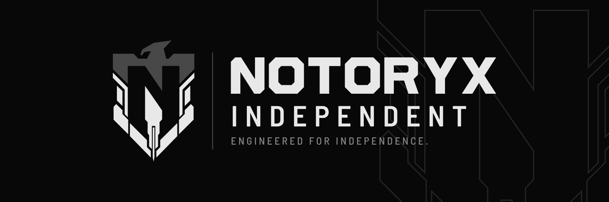
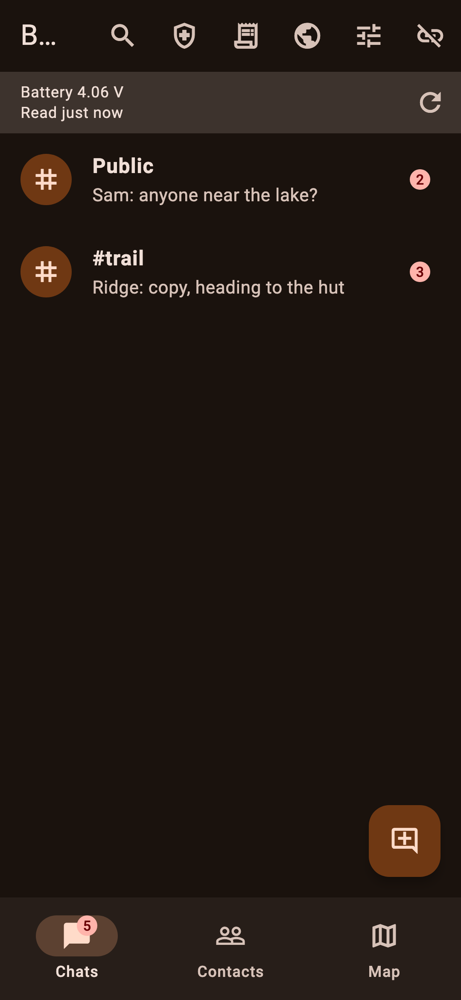
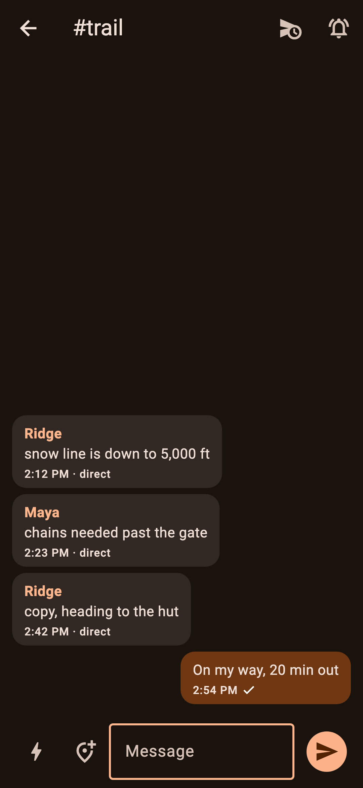
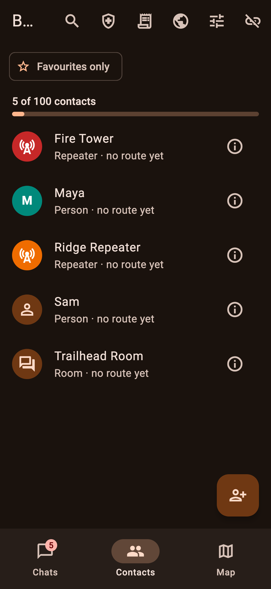
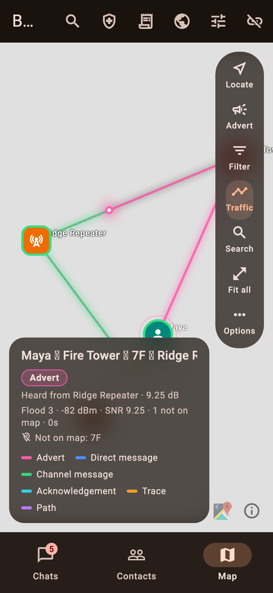
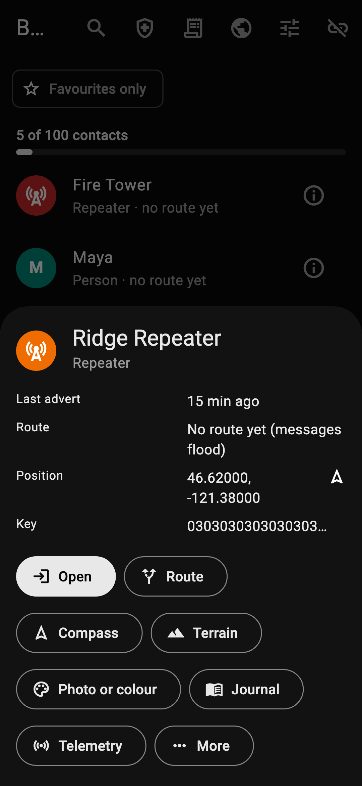
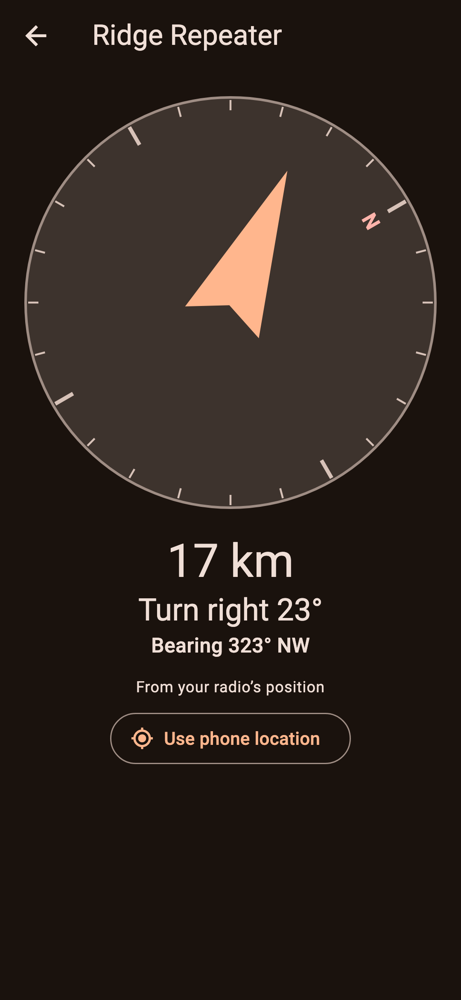
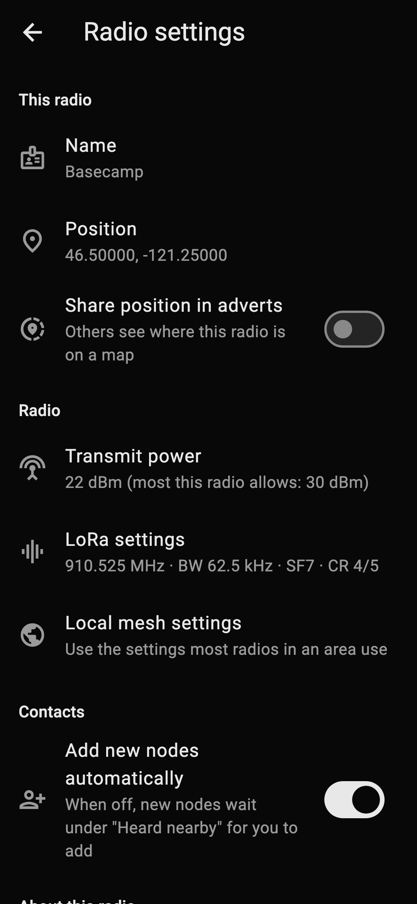
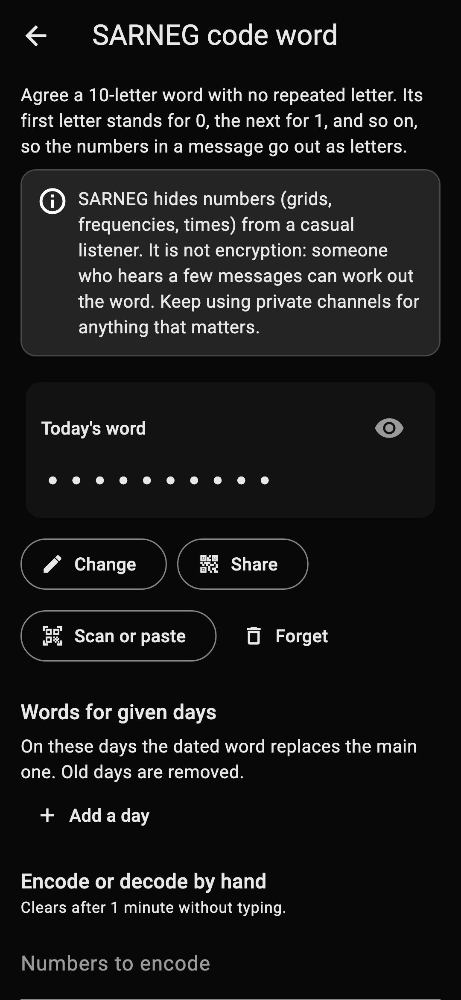
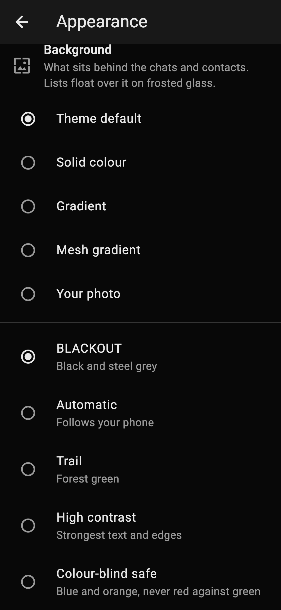

<p align="center">
  
</p>

# NOTORYX Independent

Off-grid messaging over your [MeshCore](https://meshcore.io/) LoRa radio,
for Android, Mac and Windows (iPhone builds in CI). A companion app written
from scratch for this repository, part of the NOTORYX family. MIT licensed.

<table>
  <tr>
    <td></td>
    <td></td>
    <td></td>
  </tr>
  <tr>
    <td></td>
    <td></td>
    <td></td>
  </tr>
  <tr>
    <td></td>
    <td></td>
    <td></td>
  </tr>
  <tr>
    <td></td>
    <td></td>
    <td>Screens rendered from the app with a test radio and made-up names and places, in the default BLACKOUT theme (November 21, 2026). Regenerate them with <code>flutter test tools/screenshots --update-goldens</code>.</td>
  </tr>
</table>

## Status

Test builds are out; the latest is **0.1.0 test 38** (22 November 2026), the first
with the BLACKOUT icon and default theme (not yet tested on a phone or radios). Get it from
[notoryx-core-independent-releases](https://github.com/TheLogsAreScreaming/notoryx-core-independent-releases/releases),
which also explains which file to pick and how to get automatic updates
with Obtainium.

Many features have only been checked by automated tests and CI so far, not
on real radios. Until this app matches the current NOTORYX Core, that one
keeps shipping from
[notoryx-core-releases](https://github.com/TheLogsAreScreaming/notoryx-core-releases)
and stays the one to use every day. The two install side by side:

| | Current NOTORYX Core | This app (NOTORYX Independent) |
|---|---|---|
| Android app ID | `com.bastionmesh.bastion` | `com.bastionmesh.notoryx_core` |
| Mac bundle ID | `com.bastionmesh.bastion` | `com.bastionmesh.notoryxCore` |

## What it does

**Connecting**
- Bluetooth, USB (Android and Mac) or Wi-Fi to a MeshCore companion radio;
  firmware v1.18 is the main target.
- Reconnects by itself, and stays connected in the background on Android.
- Change the radio's name, position, power and LoRa settings, or pick your
  area's usual settings from local and community presets.

**Messages**
- Channel and direct messages with retries, flood fallback and resend,
  delivery details and the route each message took.
- Unread counts, notifications, muting, search, quick messages, drafts,
  reactions, replies, forwarding and scheduled messages.
- Auto-replies, bot commands, read aloud, on-device translation, link
  previews and images from links (tap to load), and tiny photos over the
  mesh.
- Signed SOS and channel posts, blocking, highlighted mentions, and
  opt-in community moderation.
- **SARNEG code words** (Radio settings → SARNEG code word): send grid
  references, frequencies and times as letters instead of digits, from a
  10-letter word your team agrees on. A SARNEG button codes the numbers
  before you press Send, received `[SARNEG]` messages get a tap-to-decode
  line, and the word is shared by QR code or text, with optional words for
  given days. Copied text and decoded results clear after a minute, and the
  app warns about well-known words. The same format works in every NOTORYX
  app. It keeps numbers away from a casual listener; it is **not
  encryption**.

**Nodes and the map**
- Contacts with QR sharing, favourites, a contact meter, and ways to make
  room when the radio is full.
- A photo or colour for any node, shown wherever it appears (on this phone
  only).
- Map with offline areas and your own MBTiles packs, track log with GPX
  export, zone and trail alerts, wardrive coverage map.
- **Terrain check:** ground profile between you and a node, with its
  Fresnel zone and a clear / partly blocked / blocked verdict.
- **Live Traffic map** of packets heard, hop by hop, a stale-node badge and
  range rings around your position.
- **Compass:** an arrow to any node, from your radio's or your phone's
  position.
- Node journal, timeline, telemetry and noise-floor history, path trace,
  route view and picker, path graph, observer reach, packet log, and a
  nearby repeater test.

**Repeaters and rooms**
- Log in, status, console, ping, neighbours, access control, repeater
  names and IDs, antenna hunt, network scan across presets, MQTT packet
  feed.

**Safety and field work**
- SOS that repeats until answered, SOS relay, check-ins to up to six trip
  contacts, trip brief, field log, SALUTE and 9-Line reports, field guide.

**Look and privacy**
- **BLACKOUT** theme by default (black and steel grey, with red and amber
  kept for warnings), plus Automatic, Trail, High contrast and Colour-blind
  safe; chat text size; backgrounds (solid, gradient, mesh gradient or your
  own photo) with frosted-glass lists that keep text at 4.5:1 contrast.
- App lock, encrypted chat history, encrypted backup and restore,
  identity key backup.
- 18 languages (AI-translated) with a language picker.

What leaves the phone, and when, is in [`docs/PRIVACY.md`](docs/PRIVACY.md).

## The independence rule

No code from meshcore-open goes into this repository, copied or adapted.
Everything is written from MeshCore's
[companion protocol](https://github.com/meshcore-dev/MeshCore/blob/main/docs/companion_protocol.md)
and the firmware source.

CI enforces this: `tools/check_independence.py` compares every source file
against the latest meshcore-open and fails on any copied block or leftover
name. Run it locally before pushing:

```bash
git clone --depth 1 https://github.com/zjs81/meshcore-open.git /tmp/meshcore-open
python3 tools/check_independence.py /tmp/meshcore-open .
```

## Development

```bash
flutter pub get
flutter analyze
flutter test
```

To refresh the screenshots above after a UI change:

```bash
flutter test tools/screenshots --update-goldens
```

The screenshots use the Roboto and Material Icons fonts from the Flutter
SDK cache. That Roboto has no arrow glyphs (`→`), which phones draw from a
fallback font; set `SCREENSHOT_FONTS` to a folder with the same file names
(for example Roboto with arrows added) to render them.

## License

MIT, see [`LICENSE`](LICENSE). Vendored third-party code keeps its own
license: `third_party/usb_serial` is BSD-3-Clause (see its `LICENSE`).
Dependencies are listed in `pubspec.yaml` with their own licenses.
