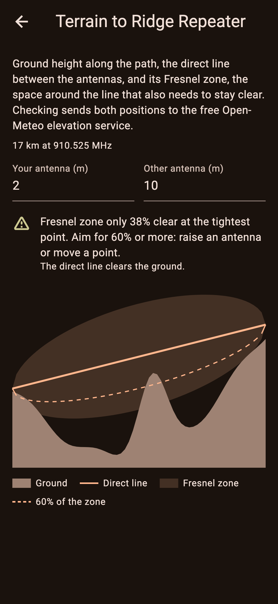
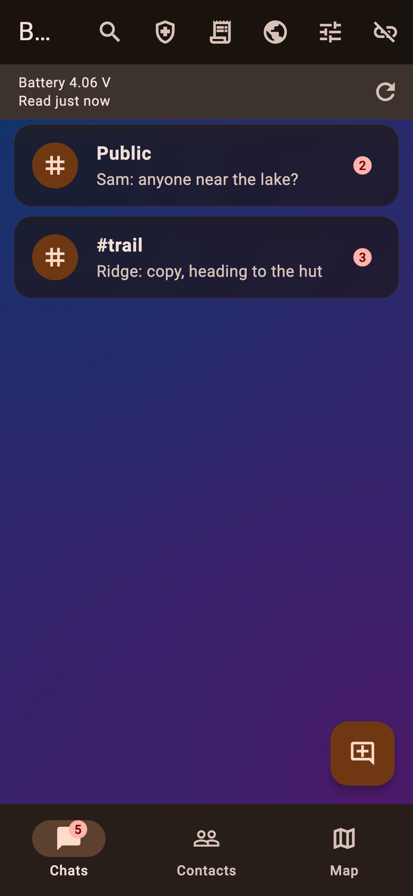

# NOTORYX Core (independent)

Off-grid messaging over your [MeshCore](https://meshcore.io/) LoRa radio,
for Android, Mac, Windows and (soon) iPhone. A companion app written from
scratch for this repository, part of the NOTORYX family. MIT licensed.

<table>
  <tr>
    <td></td>
    <td></td>
    <td></td>
  </tr>
  <tr>
    <td></td>
    <td></td>
    <td></td>
  </tr>
  <tr>
    <td></td>
    <td colspan="2">Screens rendered from the app with a test radio and made-up data, current as of test 26 (November 15, 2026). Regenerate them with <code>flutter test tools/screenshots --update-goldens</code>.</td>
  </tr>
</table>

## Status

Test builds are out; the latest is **0.1.0 test 26**. Get it from
[notoryx-core-independent-releases](https://github.com/TheLogsAreScreaming/notoryx-core-independent-releases/releases),
which also explains which file to pick and how to get automatic updates
with Obtainium.

Many features have only been checked by automated tests and CI so far, not
on real radios. Until this app matches the current NOTORYX Core, that one
keeps shipping from
[notoryx-core-releases](https://github.com/TheLogsAreScreaming/notoryx-core-releases)
and stays the one to use every day. The two install side by side:

| | Current NOTORYX Core | This app (NOTORYX Independent) |
|---|---|---|
| Android app ID | `com.bastionmesh.bastion` | `com.bastionmesh.notoryx_core` |
| Mac bundle ID | `com.bastionmesh.bastion` | `com.bastionmesh.notoryxCore` |

## What it does

**Connecting**
- Bluetooth, USB (Android, Mac and Linux) or Wi-Fi to a MeshCore companion
  radio; firmware v1.18 is the main target.
- Reconnects by itself, and stays connected in the background on Android.
- Change the radio's name, position, power and LoRa settings, or pick your
  area's usual settings from local and community presets.

**Messages**
- Channel and direct messages with retries, flood fallback and resend,
  delivery details and the route each message took.
- Unread counts, notifications, muting, search, quick messages, drafts,
  reactions, replies, forwarding and scheduled messages.
- Auto-replies, read aloud, on-device translation, link previews and
  images from links (tap to load), and tiny photos over the mesh.
- Signed SOS and channel posts, blocking, highlighted mentions, and
  opt-in community moderation.

**Nodes and the map**
- Contacts with QR sharing, favourites, a contact meter, and ways to make
  room when the radio is full.
- A photo or colour for any node, shown wherever it appears (on this phone
  only).
- Map with offline areas and your own MBTiles packs, track log with GPX
  export, zone and trail alerts, wardrive coverage map.
- **Terrain check:** ground profile between you and a node, with its
  Fresnel zone and a clear / partly blocked / blocked verdict.
- **Compass:** an arrow to any node, from your radio's or your phone's
  position.
- Node journal, timeline, path trace, route view and picker, path graph,
  observer reach, and a nearby repeater test.

**Repeaters and rooms**
- Log in, status, console, ping, neighbours, access control, repeater
  names and IDs, antenna hunt, network scan across presets.

**Safety and field work**
- SOS that repeats until answered, SOS relay, check-ins to up to six trip
  contacts, trip brief, field log, SALUTE and 9-Line reports, field guide.

**Look and privacy**
- Eight themes, chat text size, and backgrounds (solid, gradient, mesh
  gradient or your own photo) with frosted-glass lists that keep text at
  4.5:1 contrast.
- App lock, encrypted chat history, encrypted backup and restore,
  identity key backup.
- English and Spanish (AI-translated), with a language picker.

What leaves the phone, and when, is in [`docs/PRIVACY.md`](docs/PRIVACY.md).

## The independence rule

No code from meshcore-open goes into this repository, copied or adapted.
Everything is written from MeshCore's
[companion protocol](https://github.com/meshcore-dev/MeshCore/blob/main/docs/companion_protocol.md)
and the firmware source.

CI enforces this: `tools/check_independence.py` compares every source file
against the latest meshcore-open and fails on any copied block or leftover
name. Run it locally before pushing:

```bash
git clone --depth 1 https://github.com/zjs81/meshcore-open.git /tmp/meshcore-open
python3 tools/check_independence.py /tmp/meshcore-open .
```

## Development

```bash
flutter pub get
flutter analyze
flutter test
```

To refresh the screenshots above after a UI change:

```bash
flutter test tools/screenshots --update-goldens
```

## License

MIT, see [`LICENSE`](LICENSE). Vendored third-party code keeps its own
license: `third_party/usb_serial` is BSD-3-Clause (see its `LICENSE`).
Dependencies are listed in `pubspec.yaml` with their own licenses.
